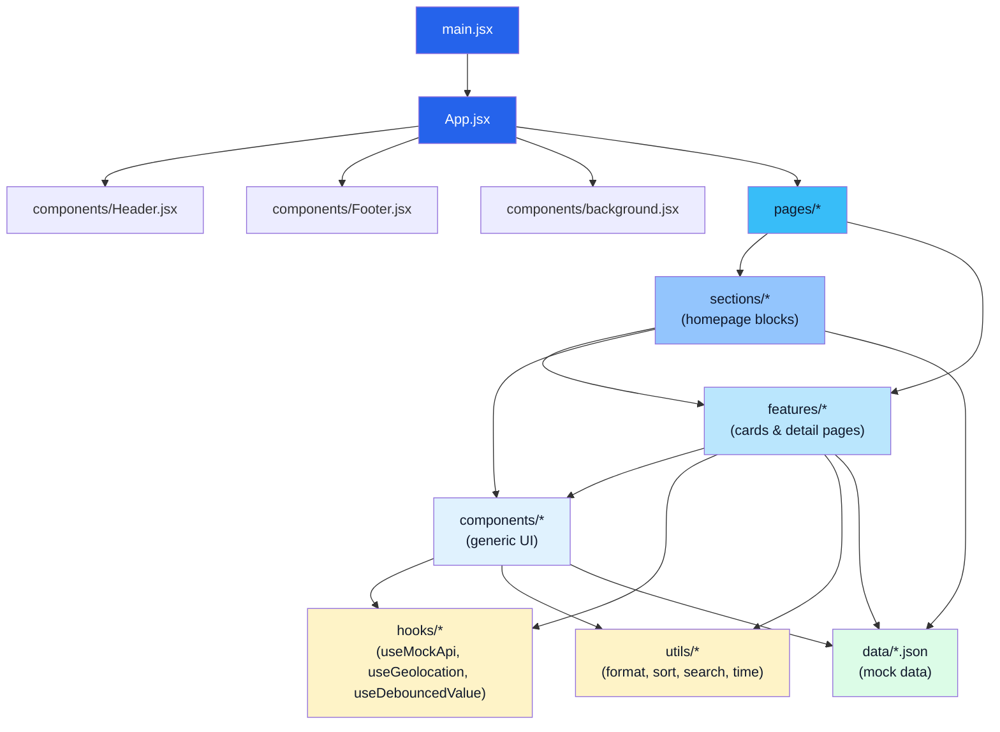
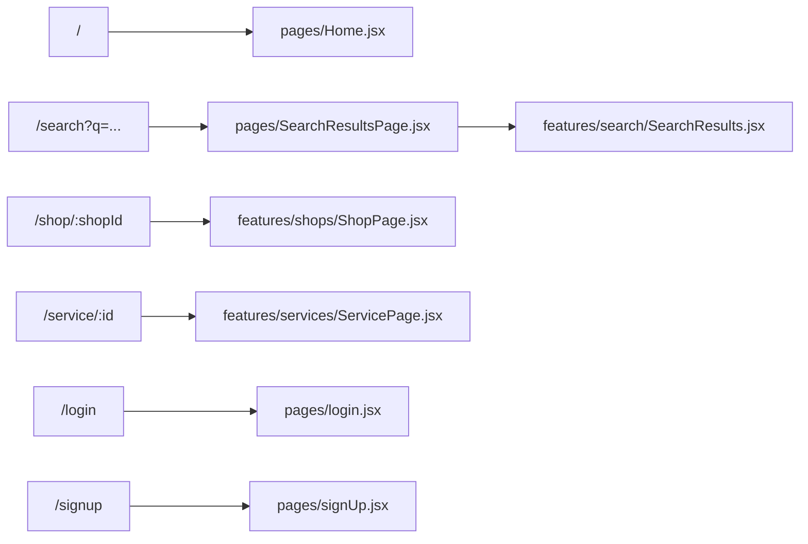

# 🗺️ Local Finder — Architecture Map

This file is the "how everything connects" reference for the project. It has four parts:

1. [Folder structure](#1-folder-structure)
2. [High-level architecture diagram](#2-high-level-architecture-diagram)
3. [Homepage composition tree](#3-homepage-composition-tree)
4. [Routing map](#4-routing-map)
5. [Full file reference table](#5-full-file-reference-table) — every file, its job, what it imports, and what imports it

---

## 1. Folder structure

```
src/
├── App.jsx                 # Routes + layout shell
├── main.jsx                # Entry point (BrowserRouter + mount)
│
├── pages/                  # One file per route
│   ├── Home.jsx
│   ├── SearchResultsPage.jsx
│   └── (login/signup moved to features/auth/ — see ../AUTH_SETUP.md)
│
├── sections/                # Homepage blocks (heading + data + cards)
│   ├── QuickCategories.jsx
│   ├── CommonServices.jsx
│   ├── RecentActivity.jsx
│   ├── NearbyShops.jsx
│   ├── TrendingProducts.jsx
│   └── SmartRecommendations.jsx
│
├── features/                # Domain-specific cards & detail pages
│   ├── home/
│   │   ├── CategoryCard.jsx
│   │   ├── ActivityFeed.jsx
│   │   └── RecommendationCard.jsx
│   ├── services/
│   │   ├── ServiceCard.jsx
│   │   └── ServicePage.jsx        (route: /service/:id)
│   ├── shops/
│   │   ├── ShopCard.jsx
│   │   ├── ProductCard.jsx
│   │   └── ShopPage.jsx           (route: /shop/:shopId)
│   └── search/
│       ├── ProductList.jsx
│       └── SearchResults.jsx
│
├── components/               # Generic, reusable, no domain logic
│   ├── Header.jsx / Navbar.jsx / Footer.jsx / background.jsx
│   ├── Hero.jsx / SearchBar.jsx / CallToAction.jsx / Testimonials.jsx
│   └── StarRating.jsx / Chip.jsx / Badge.jsx / SectionHeading.jsx /
│       HorizontalScroller.jsx / SkeletonCard.jsx
│
├── hooks/
│   ├── useMockApi.js          # fake async fetch (loading/data/error)
│   ├── useGeolocation.js      # fake "Use My Location"
│   └── useDebouncedValue.js   # debounce for search suggestions
│
├── utils/
│   ├── format.js   # price / distance / rating formatting
│   ├── time.js     # relative "X min ago" labels
│   ├── sort.js     # price sorting + cheapest lookup
│   └── search.js   # filter products/services/shops by query
│
├── data/                     # Mock "API responses" — swap for real fetches later
│   ├── categories.json
│   ├── commonServices.json
│   ├── products.json
│   ├── shops.json
│   ├── activity.json
│   ├── recommendations.json
│   └── data.js       (legacy — testimonials, etc.)
│
└── css/                      # One stylesheet per area, all built on
    ├── App.css                 CSS variables defined in App.css
    ├── Home.css               (--color-primary, --radius, --shadow-*, .card, .btn…)
    ├── ShopService.css
    ├── Hero.css / Header.css / Footer.css / Auth.css / body.css / background.css
```

---

## 2. High-level architecture diagram

This shows how the **layers** depend on each other. Arrows mean "imports / uses".



**Reading this:** data only ever flows *downward* — `sections` and `features` pull from `data/*.json`
through `hooks`/`utils`, and render using `components`. Nothing in `components`, `hooks`, `utils` or
`data` ever imports back up from `sections`/`features`/`pages` — that's what keeps the app easy to
extend (e.g. add a new homepage section without touching anything else).

---

## 3. Homepage composition tree

This is the exact render tree for `/` (Home.jsx), the most complex page:

```mermaid
flowchart TD
    Home["pages/Home.jsx"] --> Hero
    Home --> QuickCategories["sections/QuickCategories.jsx"]
    Home --> CommonServices["sections/CommonServices.jsx"]
    Home --> RecentActivity["sections/RecentActivity.jsx"]
    Home --> NearbyShops["sections/NearbyShops.jsx"]
    Home --> TrendingProducts["sections/TrendingProducts.jsx"]
    Home --> SmartRecommendations["sections/SmartRecommendations.jsx"]
    Home --> Testimonials
    Home --> CallToAction

    Hero --> SearchBar
    SearchBar --> Chip
    SearchBar -.reads.-> productsJson["data/products.json"]
    SearchBar -.reads.-> servicesJson["data/commonServices.json"]
    SearchBar -.reads.-> shopsJson["data/shops.json"]

    QuickCategories --> CategoryCard["features/home/CategoryCard.jsx"]
    QuickCategories -.reads.-> categoriesJson["data/categories.json"]

    CommonServices --> ServiceCard["features/services/ServiceCard.jsx"]
    CommonServices -.reads.-> servicesJson

    RecentActivity --> ActivityFeed["features/home/ActivityFeed.jsx"]
    ActivityFeed -.reads via useMockApi.-> activityJson["data/activity.json"]

    NearbyShops --> ShopCard["features/shops/ShopCard.jsx"]
    NearbyShops -.reads via useMockApi.-> shopsJson

    TrendingProducts --> ProductCard["features/shops/ProductCard.jsx"]
    TrendingProducts -.reads.-> productsJson

    SmartRecommendations --> RecommendationCard["features/home/RecommendationCard.jsx"]
    SmartRecommendations -.reads.-> recsJson["data/recommendations.json"]

    ServiceCard --> StarRating
    ServiceCard --> Badge
    ShopCard --> StarRating
    ProductCard --> StarRating
    ProductCard --> Badge
    Testimonials --> StarRating
```



---

## 4. Routing map

Defined in `App.jsx`:



`SearchResults.jsx` filters `data/products.json`, `data/commonServices.json` and `data/shops.json`
against the query using `utils/search.js`, then renders `features/search/ProductList.jsx`
(products, sorted cheapest-first via `utils/sort.js`), `ServiceCard`, and `ShopCard`.

---

## 5. Full file reference table

Every source file, what it does, what it depends on, and everywhere it's used.
Generated directly from the codebase's `import` statements, so it stays accurate as long as you
regenerate it after adding/removing imports (see the note at the bottom).

| File | Purpose | Imports (depends on) | Used by |
|---|---|---|---|
| `App.jsx` | Root component — mounts Background, Header, Footer and defines every route. | `Footer.jsx`, `Header.jsx`, `background.jsx`, `ServicePage.jsx`, `ShopPage.jsx`, `Home.jsx`, `SearchResultsPage.jsx`, `login.jsx`, `signUp.jsx` | `main.jsx` |
| `main.jsx` | Vite entry point — wraps App in BrowserRouter, mounts to #root. | `App.jsx` | *entry point* |
| `pages/Home.jsx` | Route / — assembles Hero + every section in order. | `CallToAction.jsx`, `Hero.jsx`, `Testimonials.jsx`, `CommonServices.jsx`, `NearbyShops.jsx`, `QuickCategories.jsx`, `RecentActivity.jsx`, `SmartRecommendations.jsx`, `TrendingProducts.jsx` | `App.jsx` |
| `pages/SearchResultsPage.jsx` | Route /search — reads ?q=, renders SearchBar + SearchResults. | `SearchBar.jsx`, `SearchResults.jsx` | `App.jsx` |
| `pages/login.jsx` | Route /login — login form + AuthInfoPanel. | `AuthInfoPanel.jsx` | `App.jsx` |
| `pages/signUp.jsx` | Route /signup — sign-up form + AuthInfoPanel. | `AuthInfoPanel.jsx` | `App.jsx` |
| `sections/CommonServices.jsx` | Homepage: row of ServiceCard. | `HorizontalScroller.jsx`, `SectionHeading.jsx`, `commonServices.json`, `ServiceCard.jsx` | `Home.jsx` |
| `sections/NearbyShops.jsx` | Homepage: row of ShopCard with skeleton loading. | `HorizontalScroller.jsx`, `SectionHeading.jsx`, `SkeletonCard.jsx`, `shops.json`, `ShopCard.jsx`, `useMockApi.js` | `Home.jsx` |
| `sections/QuickCategories.jsx` | Homepage: row of CategoryCard tiles. | `HorizontalScroller.jsx`, `categories.json`, `CategoryCard.jsx` | `Home.jsx` |
| `sections/RecentActivity.jsx` | Homepage: wraps ActivityFeed. | `ActivityFeed.jsx` | `Home.jsx` |
| `sections/SmartRecommendations.jsx` | Homepage: grid of RecommendationCard. | `recommendations.json`, `RecommendationCard.jsx` | `Home.jsx` |
| `sections/TrendingProducts.jsx` | Homepage: grid of ProductCard. | `SectionHeading.jsx`, `products.json`, `ProductCard.jsx` | `Home.jsx` |
| `features/home/ActivityFeed.jsx` | Full 'Recently Active' feed (fetches activity.json via useMockApi). | `SkeletonCard.jsx`, `activity.json`, `useMockApi.js`, `time.js` | `RecentActivity.jsx` |
| `features/home/CategoryCard.jsx` | Quick-category tile → navigates to /search?type=... | — | `QuickCategories.jsx` |
| `features/home/RecommendationCard.jsx` | Single 'Recommended for you' card with CTA. | — | `SmartRecommendations.jsx` |
| `features/search/ProductList.jsx` | Sorts products ascending by price, highlights the cheapest. | `ProductCard.jsx`, `sort.js` | `SearchResults.jsx` |
| `features/search/SearchResults.jsx` | Core search engine — filters + renders Products/Services/Shops. | `SectionHeading.jsx`, `SkeletonCard.jsx`, `commonServices.json`, `products.json`, `shops.json`, `ProductList.jsx`, `ServiceCard.jsx`, `ShopCard.jsx`, `useMockApi.js`, `search.js` | `SearchResultsPage.jsx` |
| `features/services/ServiceCard.jsx` | Service card → 'Book Now' → /service/:id. | `Badge.jsx`, `StarRating.jsx`, `format.js` | `SearchResults.jsx`, `CommonServices.jsx` |
| `features/services/ServicePage.jsx` | Route /service/:id — provider profile, pricing, contact. | `Badge.jsx`, `StarRating.jsx`, `commonServices.json`, `format.js` | `App.jsx` |
| `features/shops/ProductCard.jsx` | Product card with Cheapest/Best-Deal badge, link to shop. | `Badge.jsx`, `StarRating.jsx`, `format.js` | `ProductList.jsx`, `TrendingProducts.jsx` |
| `features/shops/ShopCard.jsx` | Shop card → 'View Shop' → /shop/:shopId. | `StarRating.jsx`, `format.js` | `SearchResults.jsx`, `NearbyShops.jsx` |
| `features/shops/ShopPage.jsx` | Route /shop/:shopId — shop header + products sorted by price. | `StarRating.jsx`, `products.json`, `shops.json`, `format.js`, `sort.js` | `App.jsx` |
| `components/AuthInfoPanel.jsx` | Shared side-panel used by Login and Sign Up pages. | — | `login.jsx`, `signUp.jsx` |
| `components/Badge.jsx` | Colored tag pill (Cheapest / Best Deal / Available Today). | — | `ServiceCard.jsx`, `ServicePage.jsx`, `ProductCard.jsx` |
| `components/CallToAction.jsx` | Final CTA banner ('Post Your Requirement' / 'Find Best Price'). | — | `Home.jsx` |
| `components/Chip.jsx` | Small pill button (trending search terms). | — | `SearchBar.jsx` |
| `components/Footer.jsx` | Site footer with link columns and copyright. | — | `App.jsx` |
| `components/Header.jsx` | Site header: logo, Navbar, Login/Sign Up buttons, mobile hamburger. | `Navbar.jsx` | `App.jsx` |
| `components/Hero.jsx` | Homepage hero: heading, subtext, SearchBar, trending chips, CTA buttons. | `SearchBar.jsx` | `Home.jsx` |
| `components/HorizontalScroller.jsx` | Horizontally scrollable row wrapper (categories/services/shops). | — | `CommonServices.jsx`, `NearbyShops.jsx`, `QuickCategories.jsx` |
| `components/Navbar.jsx` | Top nav links (Home/Products/Services/About/Contact). | — | `Header.jsx` |
| `components/SearchBar.jsx` | Reusable search input — live suggestions, 'Use My Location', trending chips. | `Chip.jsx`, `commonServices.json`, `products.json`, `shops.json`, `useDebouncedValue.js`, `useGeolocation.js`, `search.js` | `Hero.jsx`, `SearchResultsPage.jsx` |
| `components/SectionHeading.jsx` | Left-aligned 'Title + subtitle + View All' row heading. | — | `SearchResults.jsx`, `CommonServices.jsx`, `NearbyShops.jsx`, `TrendingProducts.jsx` |
| `components/SkeletonCard.jsx` | Shimmering loading placeholder for useMockApi 'fetches'. | — | `ActivityFeed.jsx`, `SearchResults.jsx`, `NearbyShops.jsx` |
| `components/StarRating.jsx` | ★★★★☆ + numeric rating + review count — reused everywhere ratings appear. | `format.js` | `Testimonials.jsx`, `ServiceCard.jsx`, `ServicePage.jsx`, `ProductCard.jsx`, `ShopCard.jsx`, `ShopPage.jsx` |
| `components/Testimonials.jsx` | Customer review cards using StarRating. | `StarRating.jsx`, `data.js` | `Home.jsx` |
| `components/background.jsx` | Decorative animated background rendered behind every page. | — | `App.jsx` |
| `hooks/useDebouncedValue.js` | Generic debounce hook for search suggestions while typing. | — | `SearchBar.jsx` |
| `hooks/useGeolocation.js` | Mock 'Use My Location' — resolves to a fixed address after a delay. | — | `SearchBar.jsx` |
| `hooks/useMockApi.js` | Simulates an async API call (loading/data/error) — swap for real fetch() later. | — | `ActivityFeed.jsx`, `SearchResults.jsx`, `NearbyShops.jsx` |
| `utils/format.js` | formatPrice / formatDistance / formatRating helpers. | — | `StarRating.jsx`, `ServiceCard.jsx`, `ServicePage.jsx`, `ProductCard.jsx`, `ShopCard.jsx`, `ShopPage.jsx` |
| `utils/search.js` | searchProducts / searchServices / searchShops / getSuggestions. | — | `SearchBar.jsx`, `SearchResults.jsx` |
| `utils/sort.js` | sortByPriceAsc / getCheapestId — price comparison logic. | — | `ProductList.jsx`, `ShopPage.jsx` |
| `utils/time.js` | timeAgo(minutesAgo) relative time label. | — | `ActivityFeed.jsx` |
| `data/activity.json` | Live/recent activity feed mock entries. | — | `ActivityFeed.jsx` |
| `data/categories.json` | Quick-category nav data: Products / Services / Jobs / Shops. | — | `QuickCategories.jsx` |
| `data/commonServices.json` | High-demand service provider mock data. | — | `SearchBar.jsx`, `SearchResults.jsx`, `ServicePage.jsx`, `CommonServices.jsx` |
| `data/data.js` | Legacy mock data (still used by Testimonials for reviews). | — | `Testimonials.jsx` |
| `data/products.json` | Trending product mock data. | — | `SearchBar.jsx`, `SearchResults.jsx`, `ShopPage.jsx`, `TrendingProducts.jsx` |
| `data/recommendations.json` | Smart recommendation mock entries. | — | `SmartRecommendations.jsx` |
| `data/shops.json` | Nearby shop mock data. | — | `SearchBar.jsx`, `SearchResults.jsx`, `ShopPage.jsx`, `NearbyShops.jsx` |

---

### How to regenerate this table

If you add, remove, or rewire files, you can regenerate the dependency table by running a small
script that scans every `import ... from './...'` / `'../...'` statement under `src/` and builds
the "imports" / "used by" columns automatically — that's exactly how this table was produced.
